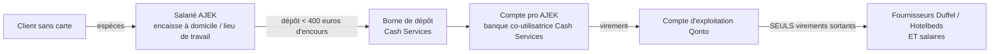

# AJEK SASU — Agence de voyage · Demande de compte professionnel & dépôt d'espèces
### Note de présentation · Version 14.0 — août 2026 · Document destiné à l'établissement bancaire

> ## ⛔ NE PAS ENVOYER EN L'ÉTAT — version périmée depuis le 2026-09-18 (soir)
>
> **Cette note demande à une banque un compte pour recevoir des remises d'espèces. AJEK ne recevra plus jamais d'espèces.** L'**agent de caisse mobile est supprimé** : plus de salarié qui encaisse au domicile, plus de transport de billets, plus de dépôt en automate Cash Services, plus de carte de dépôt nominative, plus de rapport quotidien à rapprocher. Envoyer ce texte à un établissement décrirait une activité qui n'existe pas — au mieux un dossier rejeté, au pire une présentation inexacte.
>
> **Ce qu'une version 15 devrait dire**, en trois phrases : AJEK vend des voyages et des articles de mode en ligne ; ses clients paient **sans carte bancaire et sans donner la moindre donnée bancaire**, avec un **Bon d’achat PayEnCash** (bon d'achat prépayé émis par AJEK, vendu au comptoir d'un réseau de commerçants sous contrat — art. **L521-3 I 1°** CMF, moyen de paiement à usage limité, hors agrément d'établissement de paiement) ou un **Bon d’achat PayEnCash** ; **l'argent n'arrive au compte que par un seul virement de prestataire identifié** — **Stripe** pour le prélèvement de la carte bancaire du commerçant à chaque bon d’achat vendu. Les entrées sont donc **exclusivement scripturales et rapprochables ligne à ligne**, et les sorties restent ce qu'elles étaient : fournisseurs établis et salaires. Deux points à porter à la connaissance de l'établissement, parce qu'il les verra de toute façon : la **déclaration ACPR** due au-delà d'**1 M€ d'opérations sur 12 mois** (art. L521-3 II CMF) et le fait qu'un bon d’achat **vendu mais non dépensé est une dette au bilan**, pas un produit (art. 256 ter CGI : TVA due à l'utilisation).
>
> *Le texte d'août est conservé ci-dessous comme trace de ce qui a été présenté à l'époque. **La §6 a été corrigée** : elle renvoyait à un document supprimé.*
>
> ---
>
> Cette note présente **AJEK SASU**, agence de voyage, et sa demande d'un **compte professionnel adapté à l'encaissement d'espèces**. Elle insiste sur ce que l'activité **n'est pas** (ni service de paiement, ni transport de fonds, ni intermédiation financière), afin d'écarter toute requalification.

## 1. Qui nous sommes

**AJEK SASU** est une **agence de voyage** (Marignane, Bouches-du-Rhône), **créée le 7 juillet 2026**. Nous vendons des **billets d'avion** et des **hébergements** en qualité de **partenaire enregistré Duffel et Hotelbeds** (fournisseurs établis). Nous sommes **intermédiaires** : nous prélevons une **commission de 15 à 30 %** sur les prestations vendues.

- **Notre clientèle n'a pas de carte bancaire.** Elle nous choisit parce qu'**un salarié se déplace pour encaisser la prestation en espèces**, à son **domicile** ou sur son **lieu de travail**. C'est notre **unique valeur ajoutée**.
- **Distribution** : bouche-à-oreille et **réseaux sociaux** (plusieurs milliers d'abonnés Instagram et TikTok) ; une **application** est en cours de développement.
- **Chiffre d'affaires réalisé depuis la création : 4 700 €.** Nous **ouvrons dans d'autres villes** en recrutant des **salariés** pour développer les ventes.

## 2. La problématique bancaire

Notre banque en ligne actuelle **ne permet pas d'encaisser et de déposer des espèces** dans des conditions adaptées à notre activité. Nous avons besoin d'un **compte professionnel** permettant :
- la **réception de remises d'espèces** (via un réseau de dépôt automatique) ;
- des **virements sortants strictement limités** (voir §4).

## 3. Ce que notre activité N'EST PAS — écarter toute requalification

| Requalification redoutée | Pourquoi elle ne s'applique pas |
|---|---|
| **Service de paiement** (CMF art. L521-1/L522-1) | Le salarié encaisse une **créance de son employeur** (le prix d'une vente d'AJEK), **pour le compte d'AJEK elle-même**. Aucune détention de fonds pour le compte d'un tiers, aucune intermédiation de paiement. |
| **Transport de fonds pour autrui** (Sécurité intérieure, L611-1) | AJEK transporte **ses propres recettes**, par **ses propres salariés**, avec un **encours plafonné** et déposé fréquemment. Ce n'est pas une prestation de transport de fonds pour un tiers. |
| **Établissement financier / de monnaie électronique** | AJEK **ne détient pas de fonds de clients**, n'émet aucun moyen de paiement, ne fait **aucun virement vers des tiers** autres que ses fournisseurs et ses salariés. |
| **« Livraison »** | Le terme n'est pas employé : le salarié **n'apporte aucune marchandise** (les titres de transport sont dématérialisés). Il **encaisse**, il ne livre pas. |

**En résumé : AJEK est une agence de voyage qui encaisse ses propres ventes en espèces, par ses salariés.** Rien de plus.

## 4. Des flux simples et maîtrisés — « aucun risque »

- **Entrées** : uniquement des **espèces** encaissées par nos salariés, **déposées rapidement** en borne automatique.
- **Sorties** : **les seuls virements que nous émettons vont vers nos fournisseurs établis (Duffel, Hotelbeds) et vers nos salariés.** Aucun autre bénéficiaire.
- **Encaissement borné** : **plafond de 1 000 € par transaction** (résidents fiscaux FR, art. L112-6/D112-3 CMF) + contrôle anti-fractionnement. « 1 000 €, c'est déjà beaucoup » : nos salariés **déposent dès 400 € d'encours** pour ne jamais porter davantage.
- **Cartes de dépôt nominatives** : une par salarié habilité, qui rattache chaque remise à son porteur dans le **rapport quotidien** du réseau. Aucun décaissement n'est engagé tant que les fonds ne sont pas **réellement arrivés et rapprochés**.

## 5. Trésorerie & fournisseurs

- **Hotelbeds : post-payé** — la facture est réglée immédiatement après confirmation, aucun fonds de roulement à porter.
- **Duffel : solde prépayé** — les vols sont débités en temps réel d'un solde que nous **avançons** sur notre trésorerie, **rechargé** par les espèces encaissées puis rapprochées.
- La **TVA collectée** n'est pas un revenu : c'est une **dette envers l'État**, provisionnée à part.

## 6. ~~Nos salariés~~ — **section SANS OBJET depuis le 2026-09-18 (soir)**

Le poste d'encaisseur salarié **n'existe plus** : personne ne se déplace, personne ne manipule d'espèces, il n'y a donc ni équipement à remettre, ni consigne de discrétion, ni risque de transport de fonds à encadrer. Le document d'évaluation des risques de ce poste a été supprimé du dépôt avec lui. *(L'obligation générale de tenir un DUERP subsiste tant qu'AJEK emploie quelqu'un, sur un travail désormais sédentaire — voir le §5 de `PLAN-MAITRISE-RISQUES-2026-08.md`.)*

## 7. Notre demande à l'établissement

- **Compte professionnel** au nom d'**AJEK SASU**, **à la banque co-utilisatrice du réseau de dépôt (Cash Services)** — pour recevoir les remises d'espèces.
- **Virement** de ces fonds, une fois rapprochés, vers notre **compte d'exploitation (Qonto)**, d'où partent **uniquement** les règlements Duffel/Hotelbeds et les salaires.
- **Cartes de dépôt nominatives**, en nombre croissant avec l'effectif (délivrées à l'embauche, désactivées au départ).
- **Rapport quotidien** des transactions de dépôt (rapprochement ligne à ligne, par porteur/carte).
- Communication anticipée des **volumes** (nombre de dépôts, montant moyen et maximal par remise), actualisée à chaque montée en charge.

## 8. Portée

Cette note décrit l'activité et les flux financiers d'AJEK SASU. Elle **ne constitue pas une consultation juridique** et ne se substitue pas aux avis du conseil juridique, de l'expert-comptable, ni aux vérifications propres de l'établissement.

*AJEK SASU — Marignane (13) — agence de voyage, partenaire enregistré Duffel et Hotelbeds. Contact : [nom, fonction, téléphone, courriel].*
