# Graphe d'Architecture & Cartographie Globale du Code — Voyagencash

Ce document cartographie l'intégralité du codebase de Voyagencash. Il sert de boussole technique pour les développeurs et pour l'orchestration avec **OpenAI Codex CLI** et **Google Antigravity**.

---

## 1. Graphe de Dépendances Global (Mermaid)

```mermaid
graph TD
    subgraph Frontend ["Frontend (Vanilla ES2022 / Accessible / Zero-Emoji)"]
        HTML["index.html"] --> CSS["style.css / refined.css"]
        HTML --> App["assets/js/app.js (Routeur hash & UI Controller)"]
        HTML --> ApiClient["assets/js/api-client.js (HTTP Client & Auth)"]
        HTML --> FlightEngine["assets/js/flight-engine.js (Calculateur & Math)"]
        HTML --> BookingManager["assets/js/booking-manager.js (State local & QR)"]
        HTML --> PriceCalendar["assets/js/price-calendar.js (Modal Calendrier)"]
        HTML --> FareStrip["assets/js/fare-strip.js (Bandeau 7 jours)"]
        HTML --> LiveBooking["assets/js/live-booking.js (Tunnel Live & Checkout)"]
        HTML --> StripeJS["Stripe.js (v3 Elements & 3DS)"]
        
        App --> LiveBooking
        App --> PriceCalendar
        App --> FareStrip
        App --> FlightEngine
        App --> ApiClient
        LiveBooking --> StripeJS
        LiveBooking --> ApiClient
    end

    subgraph VercelAPI ["API Serverless Vercel (12 Fonctions Max Hobby)"]
        direction TB
        C_Cfg["/api/config.js"]
        F_Src["/api/flights/search.js"]
        F_Cal["/api/flights/calendar.js"]
        O_Hld["/api/orders/hold.js (Duffel + Low-cost)"]
        O_Sta["/api/orders/status.js (Duffel + Low-cost)"]
        O_Ful["/api/orders/fulfil.js (Worker Cron)"]
        O_Wal["/api/orders/wallet.js (Pass Apple)"]
        P_Sto["/api/payencash/stores.js (Géoloc Boutiques)"]
        P_Vou["/api/payencash/voucher.js (Émission Bon Espèces)"]
        P_Web["/api/payencash/webhook.js (Notification Espèces)"]
        S_Int["/api/stripe/create-intent.js (PaymentIntent)"]
        S_Web["/api/stripe/webhook.js (Confirmation Carte)"]
    end

    subgraph ServerCore ["Serveur & Moteurs Métier (server/)"]
        S_Flt["server/flights.js (Normalisation, Cache & Duffel)"]
        S_Ryn["server/ryanair.js (API Fares & Schedules)"]
        S_Trv["server/travelfusion.js (LCC & Conciergerie Chiffrée)"]
        S_Ful["server/fulfil.js (Idempotence & Emission Billet)"]
        S_Db["server/database.js (PostgreSQL Pool & Transactions)"]
        S_Http["server/http.js (JWT, HMAC, Body & Middleware)"]
    end

    subgraph External ["Fournisseurs & Services Tiers"]
        Duffel["Duffel API (NDC / GDS Aérien)"]
        Ryanair["Ryanair Public API (CheapestPerDay / Schedules)"]
        Travelfusion["Travelfusion Adapter / Conciergerie"]
        PayEnCash["Partenaire PayEnCash (Bons Espèces BUM)"]
        Stripe["Stripe API (CB, Visa, Mastercard, Apple Pay)"]
        Postgres[(Base PostgreSQL / Neon / Supabase)]
    end

    %% Connexions Frontend -> API
    ApiClient -.->|GET /api/config| C_Cfg
    ApiClient -.->|POST /api/flights/search| F_Src
    ApiClient -.->|GET /api/flights/calendar| F_Cal
    LiveBooking -.->|POST /api/orders/hold| O_Hld
    LiveBooking -.->|POST /api/orders/status| O_Sta
    LiveBooking -.->|POST /api/payencash/voucher| P_Vou
    LiveBooking -.->|POST /api/stripe/create-intent| S_Int
    App -.->|GET /api/payencash/stores| P_Sto

    %% Connexions API -> Serveur Core
    F_Src --> S_Flt
    F_Cal --> S_Flt
    O_Hld --> S_Flt
    O_Hld --> S_Trv
    O_Sta --> S_Flt
    O_Sta --> S_Trv
    O_Ful --> S_Ful
    P_Vou --> S_Http
    P_Web --> S_Db
    S_Int --> S_Db
    S_Web --> S_Db

    %% Connexions Core -> External
    S_Flt --> Duffel
    S_Flt --> S_Ryn
    S_Flt --> S_Trv
    S_Ryn --> Ryanair
    S_Trv --> Travelfusion
    S_Ful --> Duffel
    S_Ful --> S_Db
    S_Int --> Stripe
    S_Web --> Postgres
    P_Web --> Postgres
    S_Db --> Postgres
```



---

## 2. Table de Référence des Fichiers et Rôles

| Chemin du Fichier | Couche | Responsabilités Principales |
| :--- | :--- | :--- |
| `index.html` | UI / Shell | Balisage sémantique unique (SPA), SVG icons, formulaires de recherche, panneaux de filtres et liens d'accessibilité. |
| `assets/js/app.js` | UI / Contrôleur | Machine à état hash (`#search`, `#results`, `#options`, `#passengers`, `#payment`, `#confirmation`), gestion des vues et filtres. |
| `assets/js/flight-engine.js` | Métier Isomorphe | Référentiel des aéroports (IATA, coordonnées, fuseaux horaires), calcul des distances orthodromiques, générateur déterministe de simulation. |
| `assets/js/api-client.js` | Client API | Abstraction HTTP unifiée avec timeout, gestion du mode `live` vs `demo`, détection de configuration (`/api/config`). |
| `assets/js/live-booking.js` | Tunnel Checkout | Gestion du parcours d'achat réel : saisie des passagers, appel de retenue, affichage du bon espèces ou paiement carte Stripe. |
| `assets/js/price-calendar.js` | UI Composant | Boîte de dialogue accessible affichant les tarifs indicatifs par mois avec classification en tiers (bas, moyen, élevé). |
| `assets/js/fare-strip.js` | UI Composant | Bandeau déroulant de 7 jours sur les pages de recherche et de résultats pour comparer les dates adjacentes. |
| `assets/js/booking-manager.js` | Stockage Local | Sauvegarde locale des réservations démo dans `localStorage`, calcul des totaux et génération SVG des QR codes. |
| `api/config.js` | Serverless API | Expose le statut du mode (`live` vs `demo`), la disponibilité du checkout PayEnCash et les clés publiques Stripe. |
| `api/flights/search.js` | Serverless API | Valide les paramètres et interroge simultanément Duffel, Ryanair et Travelfusion. |
| `api/flights/calendar.js` | Serverless API | Fournit la matrice tarifaire mensuelle à partir des tarifs observés et de l'API `cheapestPerDay` de Ryanair. |
| `api/orders/hold.js` | Serverless API | Crée une retenue de tarif (hold 120 min) chez Duffel, enregistre la demande low-cost ou génère une retenue de simulation. |
| `api/orders/status.js` | Serverless API | Vérifie le cycle de vie d'une commande à partir d'un jeton signé `order-access` ou `low-cost-access`. |
| `api/orders/fulfil.js` | Serverless API | Déclenché par Vercel Cron pour dépiler les commandes payées (`payment_outbox`) et émettre les billets Duffel. |
| `api/orders/wallet.js` | Serverless API | Relais vers l'adaptateur pour télécharger le pass signé `.pkpass` pour Apple Wallet. |
| `api/payencash/stores.js` | Serverless API | Liste les points de vente partenaires et filtre par proximité géographique. |
| `api/payencash/voucher.js` | Serverless API | Génère et signe cryptographiquement le bon d'achat PayEnCash pour le paiement en magasin. |
| `api/payencash/webhook.js` | Serverless API | Réceptionne les notifications d'encaissement physique avec vérification de signature HMAC SHA-256. |
| `api/stripe/create-intent.js` | Serverless API | Initialise un `PaymentIntent` Stripe sécurisé avec les métadonnées de la réservation. |
| `api/stripe/webhook.js` | Serverless API | Réceptionne l'événement `payment_intent.succeeded` de Stripe et avance l'état de la commande vers l'émission. |
| `server/flights.js` | Backend Engine | Orchestrateur de recherche multi-fournisseurs, normalisation des offres, mise en cache et enrichissement des billets. |
| `server/ryanair.js` | Connecteur Aérien | Interfaçage avec les flux publics Ryanair (`farfnd` prix les plus bas + `timtbl` horaires) avec tolérance de panne. |
| `server/travelfusion.js` | Connecteur Low-cost | Gestionnaire d'émission low-cost (EasyJet, Wizz Air, Ryanair direct) avec chiffrement AES-256-GCM des données passagers. |
| `server/fulfil.js` | Worker Durable | Machine de transition d'état idempotente avec `SKIP LOCKED` pour garantir qu'aucun billet n'est payé en double. |
| `server/database.js` | Persistance | Connexion pool PostgreSQL avec support fallback mémoire pour tests (`pg-mem`). |
| `server/http.js` | Sécurité & HTTP | Primitives de sécurité : vérification HMAC, signatures de tokens JWT légers, gestion des erreurs HTTP. |
| `server/schema.sql` | Base de données | Schéma relationnel complet (`flight_orders`, `fare_observations`, `payment_events`, `payment_outbox`, `low_cost_bookings`). |

---

## 3. Les 4 Flux de Données Majeurs

### Flux 1 : Recherche de Vols & Synchronisation Tarifaire
```text
Utilisateur saisit Trajet & Date
   │
   ├─► GET /api/flights/calendar (Bandeau 7 jours / Modal)
   │      │
   │      ├─► Observations en cache (PostgreSQL)
   │      └─► ryanair.calendarFares (cheapestPerDay)
   │
   └─► POST /api/flights/search
          │
          ├─► Duffel API (Offres NDC / GDS en direct)
          ├─► ryanair.search (Vols directs Ryanair aux tarifs confirmés)
          ├─► travelfusion.searchLowCost (Compagnies low-cost additionnelles)
          │
          ▼
   Fusion, déduplication, enrichissement (F.enrichOffer)
          │
          ▼
   Mise à jour immédiate de observations (PostgreSQL / RAM)
   pour garantir que la date sélectionnée reflète le minPrice exact.
```

### Flux 2 : Parcours de Commande & Choix du Paiement (Hybride)
```text
Sélection du Vol
   │
   ▼
Saisie des Passagers
   │
   ▼
POST /api/orders/hold
   │
   ├─► Offre Duffel : Création d'une retenue sans débit immédiat
   ├─► Offre Ryanair / Low-Cost : Enregistrement conciergerie ou Travelfusion
   └─► Offre Démo : Retenue simulée avec jeton HMAC
   │
   ▼
Choix du mode de paiement par le client :
   │
   ├─► [OPTION 1] ESPÈCES (PayEnCash) :
   │      - Requiert vol éligible à la retenue et panier ≤ 1 000 €
   │      - Appel POST /api/payencash/voucher
   │      - Affichage du QR code + Référence commerçant
   │      - Compte à rebours 120 minutes
   │
   └─► [OPTION 2] CARTE BANCAIRE (Stripe) :
          - Disponible pour TOUS les vols (y compris instantanés et > 1 000 €)
          - Appel POST /api/stripe/create-intent
          - Montage de Stripe Elements (saisie CB sécurisée)
          - Validation 3D Secure côté client
```

### Flux 3 : Confirmation & Émission des Billets
```text
Paiement Effectué
   │
   ├─► Via Espèces : Webhook PayEnCash (POST /api/payencash/webhook)
   │      ou
   └─► Via Carte : Webhook Stripe (POST /api/stripe/webhook)
   │
   ▼
Vérification HMAC SHA-256 de la signature du webhook
   │
   ▼
Transaction PostgreSQL :
   - Inscription dans payment_events (idempotence)
   - Statut de flight_orders mis à "payment_received"
   - Tâche insérée dans payment_outbox ("pending")
   │
   ▼
Worker d'émission (/api/orders/fulfil - Vercel Cron) :
   - SELECT ... FOR UPDATE SKIP LOCKED (pas de double débit)
   - Appel Duffel /air/payments pour émettre le billet officiel
   - Statut mis à "ticket_issued"
   - Ticket disponible dans Mes Billets + Export Apple Wallet (.pkpass)
```
